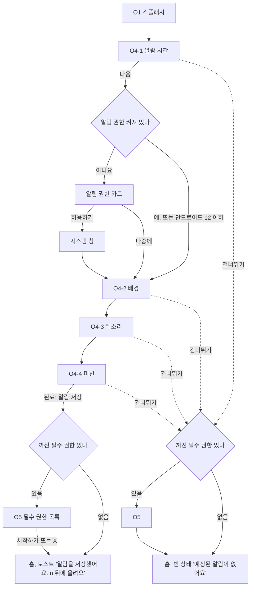

# 첫 실행 흐름 기획: 온보딩을 없애고 첫 알람 만들기로 (TSK-262)

- 작성: [기획 11], 2026-11-27. 근거: 결정 191(스플래시 → 알람 시간 → 알람 권한 → 배경 → 벨소리 → 미션 → 필수 권한 4개), 결정 178(흐름은 알라미, 모양과 문구는 우리 것), `research/M-alarmy-compare.md` 1-1, 1-2절, `research/P-alarmy-ux-flow.md` 1절.
- 문구는 `docs/plan-11-wording.md` 용어 기준을 따라요.

## 결론

| 무엇 | 정한 것 |
|---|---|
| 순서 | O1 스플래시 → O4-1 알람 시간(다음을 누르면 알림 권한 카드) → O4-2 배경 → O4-3 벨소리 → O4-4 미션 → 알람 저장 → O5 필수 권한 목록 → 홈 |
| 없애는 것 | O2-1~O2-4 권한 한 장씩, O3 위치, 온보딩 움직임 그림 3종, 진행 점 5개 |
| 새로 만드는 것 | O4-1~O4-4 첫 알람 4단계, 알림 권한 카드, O5 필수 권한 목록(한 화면) |
| 그대로 쓰는 것 | O1 스플래시(손글씨), 알람 편집의 드럼롤, 배경 격자, 벨소리 목록, 미션 타일, P6 전원 종료 방지 동의, T2 권한, PL 나중용 시트 |
| 막지 않기 | 권한을 거절해도, 단계를 건너뛰어도 홈까지 가요(알라미와 같음). 놓친 권한은 지금처럼 홈 배너 H2, T2, 밤 점검 N1이 알려요 |
| 위치 권한 | 첫 실행에서 묻지 않아요. 설정 '날씨 애니메이션'을 켤 때 P5로 물어요(필요한 순간에 묻기, P 문서 5절 1번) |

## 1. 흐름

- 이미 첫 실행을 마친 사람(지금 쓰는 사람 포함)에게는 다시 보이지 않아요. 판단은 지금 `OnboardingStore.isDone`을 그대로 써요.
- 끝났다고 표시하는 때는 **홈에 도착한 순간**이에요. 중간에 앱을 닫으면 다음에 O4-1부터 다시 해요(저장한 알람이 없으므로 겹치지 않음).
- O4-4에서 '완료'를 누른 순간 알람을 저장해요. 그 뒤 O5에서 앱을 닫아도 알람은 남고, 다음 실행은 바로 홈이에요.

## 2. 화면별 기획

공통: 위 왼쪽 뒤로(O4-1은 없음), 위 오른쪽 '건너뛰기', 위 가운데 4칸 진행 막대(O4-1~O4-4만), 아래 고정 큰 버튼. 배경은 앱 기본 화면 색(하늘 장면 아님). 시스템 뒤로 키는 이전 단계, O4-1에서는 앱을 나가요.

### O1 스플래시 (그대로)
- 지금 손글씨 스플래시(`SplashHandwriting.kt`)를 그대로 쓰고, 끝나면 O4-1로 가요(지금은 O2-1).

### O4-1 알람 시간
| 자리 | 내용 |
|---|---|
| 제목 | 몇 시에 깨워 드릴까요? |
| 본문 | 알람 편집과 같은 드럼롤(오전 오후, 시, 분, 세 줄 같은 크기). 처음 값 오전 7:00 |
| 아래 작은 글 | 매일 울려요. 요일은 나중에 바꿀 수 있어요 |
| 버튼 | 다음 |
- 반복은 **매일**로 저장해요(알라미와 같음). 요일 칩은 넣지 않아요(첫 실행을 짧게).

### O4-1a 알림 권한 카드 (O4-1 위에 뜨는 카드)
- 알림 권한이 꺼져 있고 안드로이드 13 이상일 때만, O4-1의 '다음'을 누르면 화면 아래에서 카드가 올라와요(바텀 모달).
| 자리 | 내용 |
|---|---|
| 아이콘 | Lucide `BellRing` |
| 제목 | 알람이 울릴 때 화면을 띄우려면 알림 권한이 필요해요 |
| 설명 | 허용하지 않으면 소리만 나고 해제 화면이 안 뜰 수 있어요 |
| 버튼 | 나중에(`ask_later`) / 허용하기(`ask_allow`) → 시스템 창 |
- 어느 쪽을 골라도 O4-2로 가요. 시스템 창에서 거절해도 막지 않아요.
- 시스템 창을 두 번 거절해 더 이상 뜨지 않으면 '허용하기'는 앱 알림 설정을 열어요(지금 PL 시트와 같은 처리).

### O4-2 배경
| 자리 | 내용 |
|---|---|
| 제목 | 알람 화면 배경을 골라 주세요 |
| 본문 | 위 1/3: 울림 화면 작은 미리보기(날짜, 7:00, '미션 시작'). 아래: 알람 편집 배경 시트의 격자(하늘, 자연, 단색 묶음) |
| 처음 값 | 시간대 하늘(지금 새 알람 처음 값) |
| 버튼 | 다음 |
- '내 사진' 묶음은 첫 실행에서 빼요. 사진 권한 창이 끼어들지 않게 하고, 나중에 알람 편집에서 고를 수 있어요.

### O4-3 벨소리
| 자리 | 내용 |
|---|---|
| 제목 | 어떤 소리로 깨워 드릴까요? |
| 본문 | 알람 편집 '알람음' 목록과 같은 목록. 줄을 누르면 고르고 바로 들려줘요 |
| 처음 값 | 지금 새 알람 처음 값 |
| 버튼 | 다음(누르면 듣던 소리를 멈춰요) |
- 미리 듣기 볼륨은 폰 알람 볼륨을 따르되 최대 50%로 잘라요(갑자기 크게 울리지 않게).
- 볼륨, 진동, 볼륨 천천히 올리기는 넣지 않아요. 처음 값으로 저장하고 알람 편집에서 바꿔요. 알라미는 여기서 볼륨 시트를 띄우지만, 우리는 단계를 줄이는 쪽을 골랐어요.

### O4-4 미션
| 자리 | 내용 |
|---|---|
| 제목 | 알람을 해제할 미션을 골라 주세요 |
| 본문 | 미션 타일 4개(Quick Math, Pop Quiz, Drop Words, Shake Shake)와 '미션 없이' 타일. 타일 아래 한 줄 설명은 문구 표 14~17번 |
| 처음 값 | 아무것도 고르지 않음 = 미션 없음(11-16 결정 '새 알람은 미션 없음으로 시작') |
| 고르기 | 하나만. 고른 타일은 칠로 표시(테두리 금지 규칙) |
| 버튼 | 완료 → 알람 저장 |
- 미션 설정 값은 결정 187대로 모두 1이에요. 첫 실행에서는 설정 시트를 열지 않아요.
- 흔들기 센서가 없는 폰은 Shake Shake 타일을 흐리게 하고 누르면 토스트 '이 폰에서는 쓸 수 없는 미션이에요'.

### O5 필수 권한 목록 (한 화면)
| 자리 | 내용 |
|---|---|
| 위 오른쪽 | X 닫기(= 시작하기) |
| 제목 | 알람이 제때 울리도록 아래 권한을 켜 주세요 |
| 목록 | 꺼진 권한만 줄로. 줄마다 아이콘, 이름, 결과 한 줄, 오른쪽 '설정하기' |
| 켜진 줄 | 돌아왔을 때 켜졌으면 '설정하기' 대신 체크 아이콘(Lucide `Check`), 줄은 그대로 둠 |
| 버튼 | 시작하기(늘 누를 수 있음) |

목록 줄(결정 191의 4개):

| 순서 | 줄 이름 | 결과 한 줄 | 무엇을 켜나 | 보이는 때 |
|---|---|---|---|---|
| 1 | 알람 | 잠금 화면에서도 알람 화면을 바로 띄워요 | 알림(O4-1a에서 거절했으면), 전체 화면 알림(안드로이드 14 이상), 정확한 알람(안드로이드 12) 중 꺼진 것. 누르면 꺼진 것부터 차례로 엶 | 셋 중 하나라도 꺼짐 |
| 2 | 배터리 사용 제한 해제 | 절전 모드에서도 알람이 늦지 않게 해요 | 배터리 최적화 제외 | 꺼짐 |
| 3 | 다른 앱 위에 표시 | 다른 앱을 쓰는 중에도 알람 화면을 띄워요 | 다른 앱 위에 표시 | 꺼짐 |
| 4 | 전원 종료 방지 | 미션 중 전원 메뉴가 열리면 바로 닫아요 | 접근성. 누르면 먼저 **P6 동의 바텀 모달**(화면 내용을 읽지 않는다는 안내, '동의하고 설정 열기'), 동의하면 접근성 설정 | 꺼짐 |

- 네 줄이 모두 켜져 있으면 O5를 건너뛰고 바로 홈이에요.
- 4번(접근성)을 켜고 돌아오면 설정의 '전원 종료 방지'도 켜진 상태로 둬요. 켜지 않고 '시작하기'를 눌러도 다른 기능은 그대로 써요.
- 스토어 정책 주의: 접근성은 첫 실행에서 묻더라도 P6처럼 **쓰는 이유를 먼저 보여 주고 동의를 받아야** 해요. 줄 이름을 기능 이름(전원 종료 방지)으로 둔 것도 그 때문이에요. 전원 종료 방지를 출시 때 뺄지는 11-16 결정대로 사용자가 정해요. 빼면 4번 줄만 지워요.

## 3. 없애고, 남기고, 새로 만들 것 (코드와 화면 목록 기준)

| 지금 | 처리 | 메모 |
|---|---|---|
| `O1` 스플래시, `SplashHandwriting.kt` | 남김 | 끝난 뒤 가는 곳만 O4-1 |
| `O2-1`~`O2-4` 권한 장, `OnboardingPage.kt`의 권한 장 부분 | 없앰 | O5 한 화면으로 |
| `O3` 위치 장 | 없앰 | 설정 날씨 켤 때 P5 |
| `OnboardingSteps.kt`, `OnboardingStepsTest.kt` | 없앰 | 새 단계 목록(O4-1~O4-4, O5)으로 다시 씀 |
| `OnboardingMotion.kt`, `OnboardingMotionTokens.kt`, `OnboardingPermissionMotion.kt`, `OnboardingWeatherMotion.kt` | 없앰 | 권한 장 움직임 그림 |
| `onboarding_*` 문자열(set) | 없앰. `onboarding_splash_desc`, `onboarding_skip`만 남김 | 새 문자열은 `first_run_*`로 |
| `OnboardingStore.kt` | 남김 | 끝남 표시 그대로(지금 쓰는 사람은 다시 안 봄) |
| `app/src/onboarding` 확인용 앱(ONBOARDING_ONLY) | 남김, 새 흐름을 보여 주게 바꿈 | QA가 새 흐름을 반복해서 볼 때 씀 |
| `PowerGuardSheet.kt`(P6), `PermissionPage.kt`(T2), `PermissionStepSheet.kt`(PL) | 남김 | O5 4번 줄이 P6을 씀 |
| 알람 편집 드럼롤, 배경 격자, 벨소리 목록, 미션 타일 | 남김, 첫 실행에서 다시 씀 | 부품을 화면 밖으로 꺼내 둘이 같이 씀 |
| `O4-1`~`O4-4`, `O4-1a`, `O5` | 새로 | 화면 ID를 naming.md에 넣어요 |

- naming.md에 넣을 줄: `O4-1 알람 시간`, `O4-1a 알림 권한 카드`, `O4-2 배경`, `O4-3 벨소리`, `O4-4 미션`, `O5 필수 권한 목록`. 옛 `O2`, `O3`는 '없앰(11-27 결정 191)'으로 표시하고 번호는 다시 쓰지 않아요.

## 4. 새 문구 (리소스 이름 제안)

| 리소스 | 문구 |
|---|---|
| `first_run_time_title` | 몇 시에 깨워 드릴까요? |
| `first_run_time_note` | 매일 울려요. 요일은 나중에 바꿀 수 있어요 |
| `first_run_notif_title` | 알람이 울릴 때 화면을 띄우려면 알림 권한이 필요해요 |
| `first_run_notif_desc` | 허용하지 않으면 소리만 나고 해제 화면이 안 뜰 수 있어요 |
| `first_run_bg_title` | 알람 화면 배경을 골라 주세요 |
| `first_run_sound_title` | 어떤 소리로 깨워 드릴까요? |
| `first_run_mission_title` | 알람을 해제할 미션을 골라 주세요 |
| `first_run_mission_none` | 미션 없이 |
| `first_run_mission_no_sensor` | 이 폰에서는 쓸 수 없는 미션이에요 |
| `first_run_next` / `first_run_done` / `first_run_skip` | 다음 / 완료 / 건너뛰기 |
| `first_run_perm_title` | 알람이 제때 울리도록\n아래 권한을 켜 주세요 |
| `first_run_perm_alarm` / `_desc` | 알람 / 잠금 화면에서도 알람 화면을 바로 띄워요 |
| `first_run_perm_battery` / `_desc` | 배터리 사용 제한 해제 / 절전 모드에서도 알람이 늦지 않게 해요 |
| `first_run_perm_overlay` / `_desc` | 다른 앱 위에 표시 / 다른 앱을 쓰는 중에도 알람 화면을 띄워요 |
| `first_run_perm_power` / `_desc` | 전원 종료 방지 / 미션 중 전원 메뉴가 열리면 바로 닫아요 |
| `first_run_perm_set` | 설정하기 |
| `first_run_start` | 시작하기 |

## 5. 다음 일

| 일 | 맡을 방 | 내용 |
|---|---|---|
| 디자인 | 디자인 방 | O4-1~O4-4, O4-1a, O5 라이트, 다크. 기존 부품으로 조립 |
| 개발 | 개발 방 | 3절 표대로 없애고 새로 만들기, 위치 권한을 설정 날씨 켜기로 옮기기 |
| QA | QA 방 | 새로 깐 폰(Z플립5, 앱 삭제 후 설치)에서 권한 모두 거절, 모두 허용, 중간에 앱 닫기, 건너뛰기 네 갈래 |
