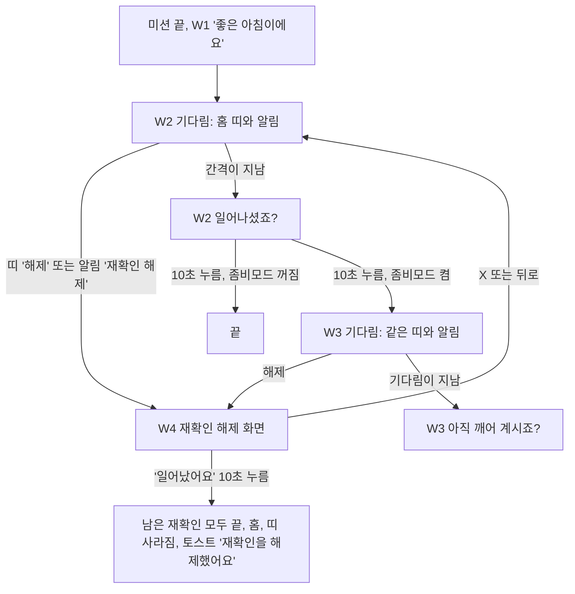

# 재확인 해제 화면 기획 (TSK-266)

- 작성: [기획 11], 2026-11-27. 근거: 11-27 사용자 "재수면 여부를 n분 후 재확인할게요 / 완전히 일어나셨으면 재확인을 해제해주세요", 결정 178(흐름은 알라미), 결정 183, 184, 188(좀비모드).
- 문구는 `docs/plan-11-wording.md` 3절을 따라요.

## 결론

- 재확인을 기다리는 동안 **홈 띠 오른쪽 '해제'** 와 **알림 패널 알림의 '재확인 해제' 버튼** 두 곳에서 해제할 수 있어요.
- 누르면 새 화면 **W4 재확인 해제**가 떠요. W2와 같은 모양으로 '일어났어요'를 **10초간 누르면** 이번 울림의 남은 재확인(W2, 좀비모드 W3)이 모두 끝나요.
- 한 번 눌러 바로 끝내지 않는 이유: 잠결에 알림 버튼 하나로 끄고 다시 자면 다시 잠들기 방지가 의미 없어요. 10초 누르기는 W2를 미리 하는 것과 같아서, 정말 일어난 사람에게는 기다림만 줄어들어요.

## 1. 언제 해제할 수 있나

| 때 | 홈 띠 | 알림 패널 | 해제 가능 |
|---|---|---|---|
| 미션 끝(W1) 뒤 W2를 기다리는 동안 | '재수면 여부를 n분 후 재확인할게요 / 완전히 일어나셨으면 재확인을 해제해주세요 / 해제' | '예정된 알람을 해제했어요 / n분 뒤 재수면 여부를 재확인할게요', 줄어드는 시계, 버튼 '재확인 해제' | O |
| W2 '일어났어요' 뒤 W3를 기다리는 동안(좀비모드 켬) | 같은 띠(n은 W3까지 남은 분) | '오전 6:43에 재수면 여부를 재확인할게요 / 완전히 일어나셨으면 재확인을 해제해주세요', 버튼 '재확인 해제' | O |
| 알람이 울리는 중, 다시 울림 쉬는 중 | 지금 띠 그대로 | 지금 그대로 | X(미션부터) |
| W2, W3 화면이 떠 있는 중 | | | X(그 화면에서 누르면 끝) |
| 다시 잠들기 방지를 끈 알람 | 띠 없음 | 알림 없음 | 해당 없음 |

## 2. 흐름

- 해제한 뒤에는 그 울림의 W2, W3가 더 뜨지 않아요. **다음 알람의 다시 잠들기 방지 설정은 그대로**예요(이번 한 번만 해제).
- W4에서 X나 뒤로를 누르면 아무것도 바뀌지 않고 기다림이 이어져요. 기다리는 시간도 그대로 흘러요.
- W4가 떠 있는 동안 기다림 시간이 끝나면 W4를 닫고 W2(또는 W3)로 바꿔요. 누르던 중이면 W2 화면으로 바뀌어도 누르는 시간을 이어서 세요(같은 버튼, 같은 10초).

## 3. W4 재확인 해제 화면

W2와 같은 틀(배경 Ring Plain 그라데이션, 메모리 '울림 화면은 단순하게')이에요. 다른 점만 적어요.

| 자리 | W2 | W4 |
|---|---|---|
| 위 왼쪽 | 없음 | X 닫기(Lucide `X`) |
| 제목 | 일어나셨죠? | 일어나셨죠? (같음) |
| 안내 | 버튼을 10초간 눌러주세요 | 버튼을 10초간 눌러주세요 (같음) |
| 남은 시간 숫자 | 1분 카운트다운 | 없음 |
| 아래 작은 글 | 시간 안에 누르지 않으면 알람이 다시 울려요 | 재확인 해제 후에는 이번 알람을 다시 묻지 않아요 (새 리소스 `recheck_release_note`) |
| 버튼 | 일어났어요(10초 누르기) | 일어났어요(10초 누르기, 같은 `HoldButton`) |
| 소리 | 사이렌(결정 185) | 없음 |
| 다 누른 뒤 | '확인했어요' 화면 | 화면을 닫고 홈, 토스트 '재확인을 해제했어요'(`home_checks_stopped`) |

- 화면 ID: **W4 재확인 해제**. 피그마 프레임 `W4 재확인 해제 / Light`, `/ Dark`(naming.md 규칙).
- 디자인 일은 W2 프레임을 복제해 위 표의 세 곳(X, 숫자 빼기, 아래 글)만 바꾸면 돼요.

## 4. 홈 띠와 알림 바꿀 점

| 자리 | 지금 | 바뀜 |
|---|---|---|
| 홈 W2 기다림 띠(`WakeCheckSoonBanner`) | 눌러도 아무 일 없음, 시각 안내 | 제목에 남은 분, 설명 '완전히 일어나셨으면 재확인을 해제해주세요', 오른쪽 '해제'. 띠 아무 데나 눌러도 W4 |
| 홈 W3 기다림 띠(`RecheckBanner`) | '확인하기' → W3 바로 | '해제' → W4. W3를 미리 여는 길은 W4로 합쳐요(10초 누르기는 같음) |
| W2 기다림 알림(`waiting()`) | 누르면 앱 홈 | 본문 누르면 앱 홈(그대로), 동작 버튼 '재확인 해제' → W4 |
| W3 기다림 알림(`recheckWaiting()`) | 누르면 W3 바로 | 본문 누르면 W4, 동작 버튼 '재확인 해제' → W4 |

## 5. 개발 메모

- 끝내는 동작은 이미 있어요: `RingEvent.CancelChecks(alarmId)`(`RingStateMachine.kt:89`, 홈에서 알람을 끌 때 쓰는 것). W4에서 10초를 다 누르면 이 이벤트를 보내요.
- W4는 울림 화면 액티비티 안의 새 단계로 두는 것을 추천해요(`EXTRA_OPEN_RELEASE`). W2, W3 화면 부품(`HoldButton`, 제목, 안내)을 그대로 써요.
- 알림 동작 버튼은 `PendingIntent.getActivity`로 W4를 열어요. 알림에서 바로 끝내는 `BroadcastReceiver`는 만들지 않아요(한 번 눌러 끝내지 않기).
- 좀비모드(실험실 '한 번 더 확인' 새 이름) 꺼짐이면 W3 관련 줄은 생기지 않아요.

## 6. 검토한 다른 안

| 안 | 내용 | 안 고른 이유 |
|---|---|---|
| A. 10초 누르기 화면(추천) | 위 설명 | |
| B. 확인 팝업 | '재확인을 해제할까요? 취소 / 해제' | 잠결에도 두 번 누르면 끝나 다시 잠들기 방지가 약해져요 |
| C. 알림 버튼으로 바로 해제 | 화면 없이 끝 | B보다 더 약해요. 알라미도 확인 화면 없이 끄는 길은 두지 않아요 |
| D. W1 화면에 해제 버튼 | 미션 끝나자마자 해제 | 미션 직후가 가장 다시 잠들기 쉬운 때라 맞지 않고, W1은 단순하게 두기로 했어요 |
