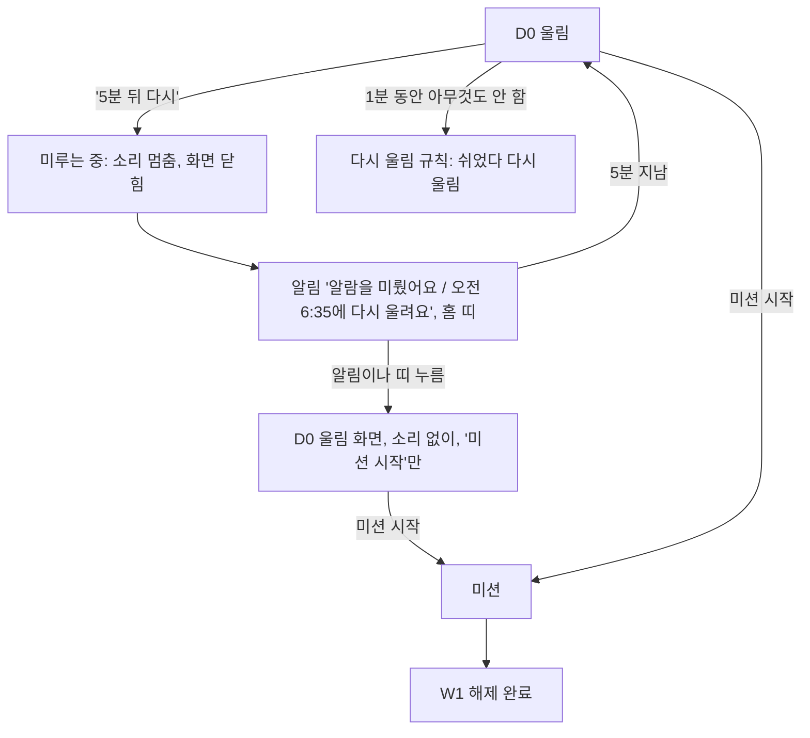

# 미루기 기획 (TSK-280, 결정 195)

- 작성: [기획 11], 2026-11-27. 근거: 결정 195(미루기 넣기), 결정 178(알라미 미루기 흐름: 편집 줄 → 간격과 횟수, 울림 화면 버튼, 다 쓰면 사라짐), 결정 186(다시 잠들기 방지 간격과 +, - 부품), `research/M-alarmy-compare.md` 1-4, 1-6절.
- 문구는 `docs/plan-11-wording.md` 1절(용어), 3-6절(리소스)에 넣었어요.

## 결론

| 무엇 | 정한 것 |
|---|---|
| 편집 줄 | 알람 편집 '다시 울림' 바로 위에 '미루기'. 토글 + 시트 규칙. 처음 값 꺼짐 |
| 시트 값 | 간격 1, 3, 5, 10분(처음 5분), 횟수 +, - 최소 1, 최대 없음(처음 3번) |
| 울림 화면 | 켰을 때만 '미션 시작' 아래 작은 글자 버튼 '5분 뒤 다시', 그 아래 '2번 남았어요'. 다 쓰면 버튼과 글이 모두 사라져요 |
| 빠지는 곳 | 미션 화면, W2 '일어나셨죠?', W3 좀비모드 확인, W4 재확인 해제에는 미루기가 없어요 |
| 이름 나누기 | **미루기** = 내가 눌러서 미룸, **다시 울림** = 해제하지 않으면 저절로 다시 울림. 두 시트에 한 줄씩 조건 설명을 둬요. 횟수 단위는 모두 '번' |

## 1. 알람 편집 '미루기' 줄과 시트

| 자리 | 내용 |
|---|---|
| 줄 위치 | 기상 미션 카드 아래쪽, '다시 울림' 바로 위. 순서: 미루기 → 다시 울림 → 다시 잠들기 방지 |
| 줄 | 이름 '미루기', 값 '5분, 3번'(꺼짐이면 '사용 안 함'), 오른쪽 스위치 |
| 스위치를 켤 때 | 시트를 열어요(설정 열기 규칙: 토글 + 시트). 처음 켜면 5분, 3번 |
| 시트 제목 | 미루기 |
| 시트 설명 | 울림 화면에서 직접 눌러 잠시 미뤄요 |
| 줄 ① 간격 | 칩 1분, 3분, 5분, 10분(다시 잠들기 방지 간격과 같은 부품) |
| 줄 ② 횟수 | +, - 부품, 최소 1, 최대 없음(결정 186과 같은 부품) |
| 버튼 | 완료 |

- 처음 값 5분, 3번은 알라미 처음 값과 같아요. 결정 187(미션 설정 처음 값 1)은 미션 설정에만 걸리는 규칙이라 여기엔 쓰지 않았어요.
- 최대가 없어도 미룰 때마다 결국 미션을 해야 꺼지므로 해제 회피 길이 되지 않아요.
- 미션 없는 알람에도 미루기를 쓸 수 있어요. 울림 화면 버튼만 '알람 해제'로 바뀌고 미루기 버튼은 같아요.

## 2. 울림 화면 (D0)

| 상태 | 화면 |
|---|---|
| 미루기 꺼짐 | 지금 그대로(하늘, 날짜, 시각, '미션 시작') |
| 미루기 켬, 남은 횟수 있음 | '미션 시작' 아래 16dp에 글자 버튼 '5분 뒤 다시'(본문 크기, 밑줄 없는 연한 글), 그 아래 작은 글 '2번 남았어요' |
| 마지막 1번 | '1번 남았어요' |
| 다 씀 | 버튼과 글이 모두 사라지고 '미션 시작'만 남아요. 다른 안내 글은 넣지 않아요(울림 화면은 단순하게) |

- '미션 시작' 튕기기(결정 190)는 미루기 버튼과 상관없이 계속돼요. 실험실 '움직이는 버튼'도 '미션 시작'에만 걸리고 미루기 버튼은 제자리예요(잠결에 누르기 쉬운 것은 미루기, 끄기 어려운 것은 미션).
- 미리 해보기(D0 미리보기)에서도 버튼을 보여 주고, 누르면 토스트 '미리 해보기에서는 미루지 않아요'.

## 3. 흐름

| 때 | 동작 |
|---|---|
| 누름 | 소리와 진동을 멈추고 울림 화면을 닫아요. 남은 횟수를 하나 줄여요 |
| 미루는 동안 | 알림 패널에 지울 수 없는 조용한 알림 '알람을 미뤘어요 / 오전 6:35에 다시 울려요. 눌러서 지금 미션을 할 수 있어요', 줄어드는 시계. 홈 위쪽 띠 '오전 6:35에 다시 울려요 / 알람을 미뤘어요. 지금 미션을 하면 바로 끝나요 / 미션 하기'(쉬는 중 띠와 같은 모양) |
| 미리 끝내기 | 알림이나 띠를 누르면 소리 없는 울림 화면이 열리고 '미션 시작'으로 바로 끝낼 수 있어요. 이 화면에는 미루기 버튼이 없어요(이미 미룬 중) |
| 시간이 되면 | 다시 울림 화면이 소리와 함께 떠요. 남은 횟수가 있으면 버튼이 또 보여요 |
| 아무것도 안 하면 | 지금 '다시 울림' 규칙(1분 울리고 쉬었다 다시)을 그대로 따라요 |

## 4. 다시 울림과 함께 쓸 때

| 질문 | 정한 것 |
|---|---|
| 횟수를 같이 세나요? | 아니요. 미루기 횟수는 버튼을 누를 때만, 다시 울림 횟수는 저절로 다시 울릴 때만 줄어요 |
| 다시 울림으로 다시 울린 화면에도 미루기 버튼이 있나요? | 네, 미루기 횟수가 남았으면 보여요 |
| 다시 울림을 다 썼으면? | 지금 규칙대로 멈추고 놓친 알람 알림. 미루기 횟수가 남아 있어도 같아요 |
| 미션 중 멈춰 돌아오면?(결정 189) | 울림 화면으로 돌아오고, 미루기 횟수가 남았으면 버튼이 보여요. 다시 미션을 시작하면 첫 미션부터 |
| W2, W3, W4 | 미루기 없음(결정 195). 미션을 끝낸 뒤라 미룰 알람이 없어요 |
| 이번만 쉬기 | 미루는 중에 누르면 지금 울림을 쉰 걸로 쳐요(결정 175 '울리는 중이나 남은 확인을 기다리는 중'과 같게) |
| 미션 포기(실험실) | 미루는 중에도 알림 패널의 미션 포기는 그대로 써요 |

## 5. 디자인과 개발에 넘길 것

| 일 | 내용 |
|---|---|
| 디자인 | S0 미루기 줄(꺼짐, 켬), 미루기 시트, D0 버튼 두 상태(남음, 마지막 1번), 홈 미루기 띠. 시트는 다시 잠들기 방지 시트를 복제해 제목과 설명만 바꿔요 |
| 개발 | 알람 모델에 `snooze(on, intervalMin, count)`, 처음 꺼짐. 울림 상태에 `Snoozed(until, left)` 단계(지금 `Resting`과 같은 틀, 시작 이유만 다름). 알림과 홈 띠는 `Resting` 것을 다시 쓰고 글만 3-6절 |
| QA | 미루기 3번 다 쓰기, 미룬 중 알림으로 미리 끝내기, 미룬 뒤 무시해 다시 울림으로 넘어가기, 미션 없는 알람 미루기, 미리 해보기 토스트 |
