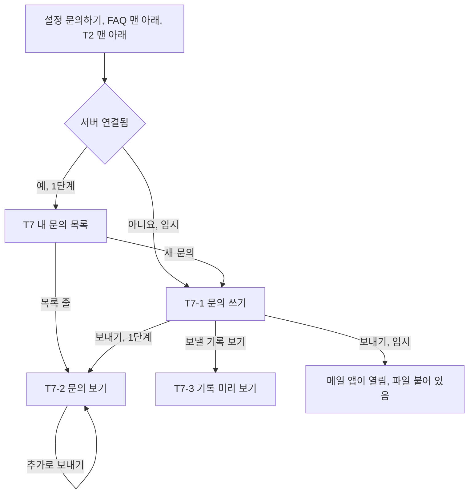

# 문의하기 화면 기획: 앱 안 문의와 답변 (TSK-277)

- 작성: [기획 11], 2026-11-27. 근거: `research/Q-in-app-support.md`(TSK-267, [리서치 6]), 사용자 요청 '이메일이 아니라 앱 안 문의와 답변', 결정 178(흐름은 알라미: 종류 → 자주 겪는지 → 내용 → 첨부 → 보내기).
- 공용 Firebase(`fuckmyprojects`)는 **아무것도 바꾸지 않았어요.** 바꿔야 할 것은 5절에 '사용자 동의 받을 것'으로만 적었어요.

## 결론

| 무엇 | 정한 것 |
|---|---|
| 목표 모양 | 앱 안에서 문의를 쓰고, 보낸 문의 목록과 답변을 앱 안에서 봐요. 메일 주소를 받지 않아요 |
| 화면 | T7 문의하기(내 문의 목록) → T7-1 문의 쓰기 → T7-2 문의 보기(답변 대화). 보조로 T7-3 보낼 기록 보기 |
| 서버 붙이기 전(임시) | 같은 T7-1 화면을 쓰고, '보내기'를 누르면 앱 기록 파일을 붙여 메일 앱으로 넘겨요. 목록과 답변 화면은 숨겨요. 서버가 붙으면 화면은 그대로 두고 보내는 길만 바뀌어요 |
| 서버(1단계) | 공용 Firebase에 익명 로그인 켜기, Firestore `diary` 안 `wakeup/` 칸, Storage `wakeup-logs/`. **사용자 동의 뒤에** 해요 |
| 답 왔다는 표시 | 앱을 열 때 확인해서 설정 '문의하기' 줄과 목록에 점. 푸시 알림은 2차 |
| 들어오는 곳 | 설정 > 도움 > 문의하기, FAQ 맨 아래 '답을 못 찾았어요', T2 권한 점검 맨 아래 '그래도 알람이 안 울리면 문의하기' |

## 1. 흐름

- 문의 목록이 비어 있으면 T7 대신 바로 T7-1을 열어요(빈 화면 한 번 더 거치지 않게).

## 2. 화면별

### T7 문의하기 (내 문의 목록, 1단계부터)
| 자리 | 내용 |
|---|---|
| 제목 | 문의하기 |
| 위 버튼 | 새 문의(큰 버튼) |
| 목록 줄 | 종류 칩(오류 신고, 궁금한 점, 제안), 내용 첫 줄, 보낸 날짜, 상태('답변 기다리는 중', '답변 왔어요'). 새 답변이 있으면 줄 오른쪽 점 |
| 순서 | 최근 것 위 |

### T7-1 문의 쓰기
| 순서 | 자리 | 내용 |
|---|---|---|
| 1 | 종류 | 칩 '오류 신고', '궁금한 점', '제안'. 처음엔 아무것도 안 고름. T2에서 들어오면 '오류 신고'가 골라진 채 열려요 |
| 2 | 자주 그런가요? | 오류 신고일 때만. 칩 '매번', '가끔', '한 번' |
| 3 | 내용 | 여러 줄 입력. 안내 글은 종류마다 달라요(4절). 10자 이상 |
| 4 | 사진 | 화면 캡처 최대 3장. 안드로이드 사진 고르기 창을 써서 사진 권한을 묻지 않아요 |
| 5 | 앱 기록 같이 보내기 | 스위치. 오류 신고면 켜진 채, 나머지는 꺼진 채. 아래 글자 버튼 '보낼 기록 보기'(T7-3) |
| 6 | 동의 | 보내는 것, 쓰는 곳, 보관 기간 세 줄과 체크 '위 내용에 동의해요' |
| 7 | 보내기 | 종류를 고르고, 내용 10자 이상, 동의 체크일 때만 누를 수 있어요 |

- 쓰다가 뒤로 가면 가운데 팝업 '쓰던 문의를 지울까요?' '계속 쓰기' / '지우기'(잃는 게 있을 때만 팝업, P 문서 2절 규칙).
- 1단계 보내기: 보내는 동안 버튼에 진행 표시, 끝나면 T7-2로 바꾸고 토스트 '문의를 보냈어요'. 인터넷이 없으면 토스트 '인터넷에 연결한 뒤 다시 보내 주세요', 쓴 내용은 그대로 둬요.
- 임시 보내기: 기록 파일을 만들고 메일 앱을 열어요. 메일 앱으로 넘기기 직전 토스트 '메일 앱에서 보내기를 눌러 주세요'. 메일 앱이 없으면 토스트 '메일 앱이 없어 보낼 수 없어요'.

### T7-2 문의 보기 (답변 대화, 1단계부터)
| 자리 | 내용 |
|---|---|
| 위 | 종류 칩, 보낸 날짜, 상태 |
| 가운데 | 대화 모양: 내 글은 오른쪽, 답변은 왼쪽(이름 '일어나 고객지원'). 붙인 사진과 기록 파일은 작은 칩 |
| 아래 | 입력 칸과 '추가로 보내기'. 답변을 받은 뒤에도 이어서 쓸 수 있어요 |
| 열 때 | 이 문의의 새 답변 점을 지워요 |

### T7-3 보낼 기록 보기
- 보낼 요약 글(`summary.txt`)을 그대로 보여 줘요. 맨 위 한 줄: '알람이 언제 예약되고 울렸는지, 권한 상태, 폰 정보만 들어 있어요. 알람 이름과 위치는 넣지 않아요.'
- 어떤 줄을 빼는 기능은 두지 않아요. 싫으면 스위치를 끄면 돼요.

## 3. 앱 기록 파일

리서치 4-3절 표를 그대로 따라요: 진단 기록 최근 7일, 앱이 꺼진 이유 최근 10건, 권한과 상태, 다음 예약, 기기, 알람 설정 요약. 알람 이름은 '알람 1'처럼 바꿔 적고, 위치, 다른 앱 목록, 연락처, 메일 주소는 넣지 않아요. `summary.txt` + `log.csv`를 zip 하나로, 2MB를 넘지 않게 오래된 줄부터 잘라요.

## 4. 문구

| 리소스 | 문구 |
|---|---|
| `support_title` | 문의하기 |
| `support_new` | 새 문의 |
| `support_type_bug` / `_question` / `_idea` | 오류 신고 / 궁금한 점 / 제안 |
| `support_freq_title` | 자주 그런가요? |
| `support_freq_always` / `_sometimes` / `_once` | 매번 / 가끔 / 한 번 |
| `support_body_hint_bug` | 언제, 무엇을 했을 때 어떻게 됐는지 적어 주세요.\n예: 오전 6:30 알람이 울리지 않았어요 |
| `support_body_hint_question` | 궁금한 점을 적어 주세요 |
| `support_body_hint_idea` | 있으면 좋을 기능이나 바꾸면 좋을 점을 적어 주세요 |
| `support_photo` | 사진 붙이기 (최대 3장) |
| `support_log` | 앱 기록 같이 보내기 |
| `support_log_view` | 보낼 기록 보기 |
| `support_log_note` | 알람이 언제 예약되고 울렸는지, 권한 상태, 폰 정보만 들어 있어요. 알람 이름과 위치는 넣지 않아요. |
| `support_consent_items` | 보내는 것: 문의 글, 붙인 사진, 폰 정보, 앱 기록 |
| `support_consent_purpose` | 쓰는 곳: 문의 답변과 오류 고치기 |
| `support_consent_keep` | 보관: 답변이 끝나고 90일 뒤 지워요 |
| `support_consent_check` | 위 내용에 동의해요 |
| `support_send` | 보내기 |
| `support_sent` | 문의를 보냈어요 |
| `support_offline` | 인터넷에 연결한 뒤 다시 보내 주세요 |
| `support_mail_hint` | 메일 앱에서 보내기를 눌러 주세요 |
| `support_no_mail` | 메일 앱이 없어 보낼 수 없어요 |
| `support_status_waiting` / `_answered` | 답변 기다리는 중 / 답변 왔어요 |
| `support_team` | 일어나 고객지원 |
| `support_follow_up` | 추가로 보내기 |
| `support_exit_title` / `_keep` / `_discard` | 쓰던 문의를 지울까요? / 계속 쓰기 / 지우기 |
| `faq_not_found` | 답을 못 찾았어요 |
| `permission_contact` | 그래도 알람이 안 울리면 문의하기 |

- 임시 방식 메일: 받는 주소는 사업자 대표 메일을 코드 상수로 둬요(이 문서와 관리판에는 적지 않음). 제목 '[일어나 문의] 종류, 문의 번호', 본문은 지금 `settings_feedback_body`(기기, 안드로이드, 앱 버전, 꺼진 권한) 위에 쓴 내용. 문의 번호는 설치 번호 앞 8자 + 날짜.
- 임시 방식의 '보관 90일'은 메일함에서 지키는 규칙이에요. 동의 글은 두 방식이 같아요.

## 5. 서버(1단계): 사용자 동의 받을 것

Leader가 사용자에게 한 번에 물을 목록이에요. 동의 전에는 아무것도 하지 않아요.

| # | 바꾸는 것 | 영향 | 비용 |
|---|---|---|---|
| 1 | 공용 Firebase에 안드로이드 앱 '일어나'(`com.lumian.wakeup`) 등록, README 2번 표에 줄 추가 | 다른 앱 영향 없음 | 0 |
| 2 | 로그인 방식에 **익명 로그인** 켜기 | 프로젝트 전체 설정. 다른 앱은 그대로 Google 로그인 | 0 |
| 3 | Firestore `diary` 저장소 안 `wakeup/{uid}/tickets/...` 칸, 규칙에 `wakeup` 블록 더하기 | 규칙 파일이 한 벌이라 잘못 올리면 오늘일기가 멈출 수 있어요. 기준본에 더해서 전체를 올리는 README 6번 절차로 | 무료 한도 안 |
| 4 | Storage `wakeup-logs/` 칸, 2MB 이하 zip만, 90일 뒤 지우기 규칙 | 같음 | 무료 한도 안 |
| 5 | App Check(Play Integrity), 하루 문의 5건 제한 | 스팸 막기 | 0 |

- 답변 쓰기: 처음엔 Firebase 콘솔에서 `messages`에 답 글을 직접 넣어요. 문의가 늘면 답변용 작은 관리 화면을 따로 기획해요.
- 개인정보 처리방침과 Play 데이터 보안 양식(앱 활동, 진단 정보, 사용자 제공 콘텐츠)은 1단계 출시 전에 고쳐요. 임시 방식은 사용자가 메일 앱에서 직접 보내 앱이 서버로 보내지 않아요.

## 6. 다음 일

| 일 | 방 | 내용 |
|---|---|---|
| 디자인 | 디자인 방 | T7, T7-1(종류별 세 상태, 보내기 비활성), T7-2, T7-3, 쓰기 나가기 팝업. 라이트, 다크 |
| 개발 임시 | 개발 방 | T7-1 + 기록 zip + 메일 앱 넘기기(서버 없음). 비공개 테스트 중 바로 쓸 수 있어요 |
| 개발 1단계 | 개발 방 | 5절 동의 뒤. T7, T7-2, 익명 로그인, Firestore, Storage |
| 사용자 동의 | Leader | 5절 표 |
