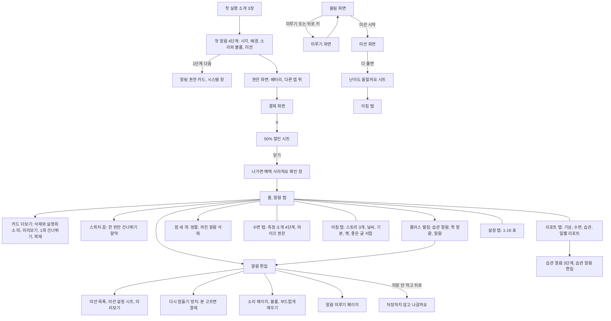

# M. 알라미 화면별 흐름 기록과 우리 앱 대조 (TSK-193)

- 조사: [리서치 2] 1단락, [리서치 3] 2단락, 2026-11-25, Z플립5, 알라미 26.43.0 (플레이스토어, 기본 사용자 공간 user 0, 설치 14:01)
- 계정 만들기, 로그인, 결제, 체험 시작은 하지 않음. 캡처는 `docs/exports/tsk-193/` (번호가 아래 화면 번호)
- 상태: **기록 끝 (1단락 01~52, 2단락 53~112, 3단락 113~123)**. 대조표와 추천은 4~6절, 재확인과 미루기 중 끄기는 5-1절

## 0. 시험 중 알게 된 것 (중요)
- 폰 알람 소리(stream 4)를 1로 낮춰 두었는데, 알라미가 울릴 때 **11로 올려 버렸어요.** 알라미는 알람마다 자기 볼륨(처음 95%)을 따로 가지고 울릴 때 폰 볼륨을 덮어써요. 다음 시험부터는 알라미 안 볼륨을 가장 낮게 하고, 울리는 동안 stream 4를 계속 1로 눌러요.
- 알라미는 알람 소리(USAGE_ALARM)뿐 아니라 미디어 소리(USAGE_MEDIA)로도 울려요(Leader가 기록으로 확인). 폰 볼륨을 낮추는 것으로는 막을 수 없어요.
- **시험 알람 규칙(11-25 사용자 지시, Leader 전달):** ① 알람마다 소리 종류를 '무음'(앱 리소스에는 Ringtone / Music / Silent, 'Vibration only' 있음. 한국어 이름은 화면에서 확인)으로 고르고 ② 앱 안 볼륨을 0으로 맞춘 뒤 ③ 두 가지를 화면에서 확인하고 나서야 울려요. ④ 그래도 소리가 나면 바로 `adb shell am force-stop droom.sleepIfUCan`. 울리는 동안 `dumpsys audio`로 소리 내는 앱을 지켜봐요. ⑤ 울림은 짧게, 화면 기록 위주로 하고 소리는 확인하지 않아요. ⑥ 다른 소리 설정은 바꾸지 않아요. 끝나면 stream 4는 11, stream 3은 1로 되돌려요(지금 stream 4=1, stream 3=0). '미션 중 음소거'가 유료로 잠겨 있으면 기록만 해요.
- 울리는 중 시스템 '뒤로' 키를 누르면 **바로 미루기(스누즈)** 가 돼요(5분, '알람 미루기 2번 남음').

## 1. 화면별 기록 (들어가는 길 → 보이는 것 → 누를 수 있는 것 → 다음)

### 1-1. 첫 실행 (01~03)
- 소개 3장: '전 세계 1위 알람 앱' → '기본 알람보다 확실하게 깨워주는 알람' → '국제 의학저널에 등재된 유일한 알람'. 아래 큰 버튼 '다음', 마지막은 '알라미 시작하기'.

### 1-2. 첫 알람 만들기 4단계 (05~15) — 상단 'n/4'
1. '알람을 언제 울릴까요?' 드럼롤(오전/오후, 시, 분, **위아래 줄 3칸, 가운데만 진함**), 처음 값 7:00.
   - 1단계에서 '다음'을 누르면 **알림 권한 안내 카드**가 화면 안에 뜸: '알람이 울리려면 꼭 필요해요 / 알림 권한을 허용해주세요 / 알림 기능이 꺼져있으면 알람이 울릴 때 확인하기 어려워요' + '허용 안함', '허용' → 시스템 권한 창.
2. '알람 배경을 선택하세요': 영상 배경 카드 3열 격자(KPOP 인기, 요즘 인기, 동기부여 묶음). 고르면 울림 화면 미리보기(날짜, 7:00, '영상 소리로 알람이 울려요') → '다음'.
3. '알람 소리를 선택하세요': 위 칩(현재 사용 중, KPOP 인기, 요즘 인기), 아래 목록 → '다음' 누르면 **볼륨 시트**: 볼륨 막대(95%), '부드럽게 깨우기 / 30초 간 서서히 커져요' 스위치, '미리듣기', '다음'.
4. '알람 미션을 선택하세요': 수학 문제, 색깔 타일 찾기, 우리집 물건 찾기(AI), 리듬 맞춰 말하기(NEW), 흔들기, 사용안함. 고르면 설명 시트('수학문제를 풀면 알람이 꺼져요 뇌까지 확실히 깨워요!') → '다음'.
- 다음: **권한 화면** '알람이 울리려면 아래 권한들이 꼭 필요해요': 배터리 최적화 중지, 다른 앱 위에 표시(설정하기). X로 닫을 수 있음(이번엔 허용하지 않고 닫음).
- 다음: **결제 화면**(20) 연간 75,000원(월 6,250원, 30% 할인 표시), 월간 8,900원, 평생 180,000원, 후기, '30% 할인 받고 시작하기'. X → **이탈 할인 시트**(22) '신규 유저 혜택 지금 화면에서만 구독 50% 할인' 연 37,500원 → 닫기 → **확인 창**(24) '나가면 혜택이 사라져요 그래도 나갈까요?' '나가기 / 혜택 받기'. 결제 화면을 3겹으로 막음.
- 끝나면 홈에 매일 7:00 알람 '🐤 일찍 일어나기'가 이미 만들어져 있음.

### 1-3. 홈 (25)
- 맨 위 배너(이벤트 알람, 예: 아이돌·웹툰 알람 단독공개), 'n시간 n분 후에 울려요'(누를 수 있음), 알람 카드(요일 7칸 표시, 오전 7:00, 이모지+이름, 오른쪽 위 스위치, 오른쪽 아래 더보기), 오른쪽 아래 '알람 설정'(+) 둥근 버튼, 하단 탭 5개(알람, 수면, 아침, 리포트, 설정), **맨 아래 광고 띠**.
- 처음 저장하면 평가 묻기 창 '알라미와 첫만남! 사용해보니 어땠나요?' '글쎄요 / 좋아요!' (41).
- **카드 더보기 메뉴**(42): 삭제, 알람 미리보기, **알람 1회 건너뛰기**, 알람 복제.
  - '알람 1회 건너뛰기'를 누르면 확인 없이 바로 적용. 위 문구 '1일 후에 울려요', 카드 시각 아래 **'내일 알람이 울려요'** 한 줄이 생김(43).
  - 다시 메뉴를 열면 '알람 1회 건너뛰기 **취소**'로 바뀜(44). 누르면 바로 원래대로.

### 1-4. 알람 편집 '기상 알람' (26~28)
- 위: 뒤로, 제목 '기상 알람'. 이모지+이름 줄(누르면 바꿈), 'n시간 n분 후에 울려요', 드럼롤(3줄).
- '매일' 체크 + 요일 칩 7개(일~토).
- '기상 미션 1/5': 미션 칸 5개(첫 칸 수학 '2회', 나머지 +). **2번째 칸부터 유료 잠금**(누르면 결제 화면).
- '다시 잠들기 방지 HOT 사용 안함' → 설명 시트('기상 인증 못하면 알람이 다시 울려요', '사용해보기') → 페이지 '알람 해제 후 진짜 일어났는지 확인할게요 / 알람 해제 몇 분 후에 물어볼까요?' 사용 안함, 1, 3, 5, 7, 10분 후(라디오). 위 설명 '버튼을 눌러 기상을 인증해요'. **분을 고르면 결제 화면(유료)**.
- '전원 끄기 방지 꺼짐'.
- '알람 소리': 현재 소리 카드, 볼륨, '부드럽게 깨우기 30초 동안', '시간 읽어주기(샘플)', '날씨 읽어주기(샘플)', '메모 읽어주기', '깜짝 사운드 더하기' 스위치.
- '커스텀 설정': '알람 미루기 5분, 3회', '알람 배경화면'.
- 맨 아래 고정 '저장'.
- **알람 미루기 페이지**(29): 위 스위치, '간격' 1분/5분/10분/옵션 더보기, '횟수 제한' 무제한/1회/2회/3회/옵션 더보기(라디오).

### 1-5. 미션 고르기와 수학 미션 (34~39)
- 미션 목록 페이지: 인기있는 미션(우리집 물건 찾기 AI, 리듬 맞춰 말하기 NEW) / 정신부터 깨우는 미션(색깔 타일 찾기, 따라쓰기, 수학 문제 BEST) / 몸부터 깨우는 미션(걷기 HOT, QR/바코드, 흔들기, 사진찍기, 스쿼트).
- QR/바코드: '아침 행동과 관련된 것을 스캔하세요' + '스캔하기'.
- 수학 문제 설정(35): 위 '예제' 영역, 난이도 막대(매우 쉬움~어려움, 위에 현재 단계 글), 문제 수 드럼롤(단위 '회'), 아래 '미리보기'(작은 버튼) + '완료'(큰 버튼).
- 미리보기(36): 울림 화면 그대로(날짜, 시각, 이름, '3 알람 미루기', '미션 시작', 위아래 광고) + 맨 아래 '미리보기 종료'.
- 수학 미션 화면(37): 위 '뒤로', 'n/2', 음소거 아이콘. 매우 쉬움은 **보기 3개 고르기**. 틀리면 그대로 머무름(눈에 띄는 벌 없음), 맞으면 다음 문제. 다 풀면 미리보기는 설정 화면으로 돌아감.

### 1-6. 실제 울림 (47~51), 14:13 시험 알람
- 울림 화면(미리보기와 같음): 날짜, 시각, 이름, '알람 미루기'(남은 횟수 숫자), '미션 시작', 위아래 광고.
- 미션 화면 위에도 광고 띠가 있음.
- 미루기 화면(49): 큰 남은 시간 '04:56', '알람 미루기 2번 남음', '미션 시작'.
- 미션을 다 풀면 → 시트 '다음 알람부터는 난이도를 올려볼까요?'(주관식 예 '2+9 = 11') '괜찮아요 / 좋아요'(50).
- 그다음 → **'아침' 탭**(51): 날씨 브리핑, 오늘의 한마디, 매일 운세, 현재 날씨(도시, 기온, 최고 최저), 아침 기분, 펫 키우기.

### 1-7. 설정 탭 (45~46)
- 로그인이 필요해요(프로필), 프로 업그레이드, 전원 끄기 방지(off), 앱 삭제 방지, 알람 울림 최적화, 알람 고급설정(알람, 미션 고급설정, 알람 회피 방지), 테마 설정, 사운드 출력(현재 기기 사용).
- 알람 고급설정: 알림 창에 대기 알람 표시('[다음 알람] 08:30' 예시 그림), 알람 자동 해제(일정시간 무응답 시 꺼짐, 사용안함), 미션 중 음소거, 미션 중 음소거 최대 횟수 3회, 알람 전 수정 방지(사용안함).

### 1-8. 알람 끄면 뜨는 '한 번만 건너뛰기' (53~54) ★우리 '이번만 쉬기'와 거의 같음
- 들어가는 길: 홈에서 반복 알람 스위치를 끔.
- 보이는 것: 카드 위에 떠 있는 작은 알약 '한 번만 건너뛰기 ×'. 위 문구는 '예정된 알람 없음'.
- 누를 수 있는 것: 알약을 누르면 → 스위치는 꺼진 모양 그대로, 시각 아래 '금요일에 알람이 울려요'(이틀 뒤면 요일, 하루 뒤면 '내일 알람이 울려요'), 위 문구 '1일 후에 울려요'. ×를 누르면 알약만 사라지고 알람은 꺼진 채.
- 확인 창 없음. 되돌리기는 카드 더보기의 '알람 1회 건너뛰기 취소'.
- 수요일 오후(그날 울림이 이미 지난 뒤)에 눌렀더니 **목요일을 쉬고 금요일**로 감. 알라미는 '지금부터 다음 한 번'을 쉬는 방식(우리 결정 156과 다름).
- 편집 화면을 열면 위 문구가 건너뛰기를 무시한 '23시간 52분 후에 울려요'로 보임(67). **편집 화면에서 저장하면 건너뛰기가 말없이 풀림**(설정을 바꾸지 않아도). 그냥 뒤로 나가면 그대로.
- 건너뛴 알람을 복제하면 건너뛰기 상태까지 복사됨(83).

### 1-9. 홈 더보기, 새 알람 메뉴, 복제, 삭제, 빈 상태 (82~86, 109~112)
- 홈 오른쪽 위 '⋯' → 작은 메뉴: 정렬(기본, 켜진 알람 우선), 꺼진 알람 삭제.
- 'n시간 n분 후에 울려요' 문구를 누르면 → 다음에 울릴 알람의 편집 화면.
- '+' 버튼 → 펼침 메뉴 3개: 습관 알람, 퀵 알람, 알람.
  - 알람 → 편집 화면 바로(온보딩 4단계 없음). 처음 값: 지금 시각, 매일, 이름 칸 '알람 이름을 입력해주세요', 미션 0/5, '1분 이내에 울려요'. 바꾼 게 없어도 뒤로 가면 '알람을 저장하지 않고 나갈까요? 취소 / 나가기'.
  - 퀵 알람(110) → 시트: 'N 분', '오후 02:40에 울림', 칩 1분, 5분, 10분, 15분, 30분, 1시간(누를수록 더해짐), 알람 소리 줄, '저장'.
  - 습관 알람 → 1-14 참고.
- 요일: '매일' 체크박스(오른쪽)로 전체 켜고 끔. 모두 끄면 왼쪽 글이 **'한 번만'**, 일부만 고르면 '일, 월, 화, 수, 토'처럼 나열. 한 번만 알람 카드는 요일 칸 대신 '한 번만'(85), 더보기에 '1회 건너뛰기'가 없음.
- 저장: 확인 토스트를 보지 못함(바로 홈으로, 카드 추가).
- 삭제: **확인 창 없이** 바로 지우고 아래 띠 '알람이 삭제되었습니다. 실행취소'(86).
- 알람 0개 빈 상태(112): 가운데 '아직 알람이 없어요' 한 줄, 위 '예정된 알람 없음', 배너와 '+'는 그대로.
- 메인 탭에서 뒤로 → 확인 창 '종료하시겠습니까? 밥은 잘 먹었어요? 그럼 안녕!' '취소 / 나가기'(73).

### 1-10. 미션별 설정 화면과 난이도 (87~97, 103~107)
- 들어가는 길: 편집 → 기상 미션 칸 → 미션 목록 시트(1-5) → 미션 하나.
- 공통 모양: 시트 위 제목, '예제' 영역(난이도에 따라 바뀜), 난이도 막대(위에 현재 단계 글, 양 끝 '쉬움 / 어려움'), 횟수 드럼롤(위아래 연하게), 아래 '미리보기'(작게) + '완료'(크게).

| 미션 | 설정 | 난이도 | 무료 |
|---|---|---|---|
| 수학 문제 BEST | 난이도, 문제 수(회) | 7단계: 매우 쉬움(보기 3개 고르기) → 쉬움(한 자리 더하기) → 보통(두 자리 더하기) → 어려움(세 수 더하기) → 매우 어려움(곱하기+더하기) → 엄청 어려움 → 지옥 모드(세 자리 곱하기+네 자리 더하기) | 무료 |
| 색깔 타일 찾기 | 난이도, 라운드 수 | 5단계(매우 쉬움~매우 어려움). 3×3 칸이 잠깐 칠해졌다 사라지면 같은 칸을 찾기 | 무료 |
| 따라쓰기 | 횟수, 문장 고르기(40문장) | 없음 | 무료 |
| 흔들기 | 횟수(처음 30) | 없음 | 무료 |
| 우리집 물건 찾기 AI | 물건 고르기(19개) | 없음, 집에 없으면 다시 뽑기 | 카메라 권한 필요('권한 허용하기') |
| 리듬 맞춰 말하기 NEW | 주제(9개), 횟수, 배경음 크기 | 없음, 효과음 나옴 | 마이크 권한 필요 |
| 사진찍기 | 등록할 사진 찍기 | 없음 | 무료(카메라) |
| QR/바코드 | 스캔 등록 | 없음 | 무료(카메라) |
| 걷기 HOT | 걸음 수(처음 20) | 없음 | **유료**(버튼이 '프로 시작하기') |
| 스쿼트 | 횟수(처음 20) | 없음 | **유료** |

- 미션 화면 공통(103~107): 위 '<', 'n/N', 오른쪽 음소거 아이콘, 맨 위 얇은 시간 막대. 미리보기면 맨 아래 '× 미리보기 종료'.
  - 색깔 타일: 틀린 칸은 무시(벌 없음), 맞은 칸은 칠한 채 남고 글이 'N개 남았어요'로 바뀜.
  - 따라쓰기: 위에 회색 문장, 아래 '0 / 8' 글자 수, '완료' 버튼, 키보드가 바로 뜸.
  - 흔들기: '정해진 횟수만큼 흔들어 알람을 해제하세요' 안내. 센서 미션이라 실행 안 함(미리보기 첫 화면만 봄). 걷기, 스쿼트도 센서 미션이라 실행 안 함.
  - 미션 중 '<'를 누르면 → 울림 화면으로 돌아가고 소리가 다시 남.

### 1-11. 소리 고르기와 볼륨 (98~102, 108)
- 편집 '알람 소리' 묶음: 소리 카드(재생 버튼 + 이름 + >), 볼륨 막대(왼쪽 스피커, 오른쪽 진동 아이콘과 체크박스), 부드럽게 깨우기, 시간 읽어주기, 날씨 읽어주기(샘플 듣기), 메모 읽어주기(잠금), 깜짝 사운드.
- 볼륨을 맨 왼쪽까지 내리면 스피커가 **음소거 아이콘**으로 바뀜(102). 이 판에는 소리 목록에 '무음' 항목이 따로 없음. 무음은 볼륨 0 + 진동 체크로 만듦.
- 소리 페이지(99): 위 가로 칩(아이돌 묶음, 요즘 인기, 시끄러운, 클래식, 자연, 경쾌한, 잔잔한, 시험/공부, 동기부여, 밈/재미, 종교, 크리스마스, 기기 소리), 아래 긴 목록. 칩을 누르면 그 묶음으로 목록이 내려감. '기기 소리'는 '랜덤 재생' + 이름순 수십 개. 오른쪽 아래 '소리 추가' → 시트 '직접 추가하기: 내 음악 가져오기, 녹음하기'(101).
- 부드럽게 깨우기 시트(108): '설정한 시간 동안 소리가 점점 커져요', 사용 안함, 15초, 30초(처음 값), 60초, 5분, 10분(라디오). adb 누르기로는 선택이 바뀌지 않았음.
- 소리 시험 메모: 볼륨 0이어도 알라미는 미리보기와 울림 때 알람 소리 트랙을 열어요(시스템이 '볼륨 0 앱'으로 분류, 실제 크기 약 -78dB). 부드럽게 깨우기 중에는 조금씩 올라가서(-78 → -73dB) 실제 울림 시험은 다시 하지 않았어요. 미리보기에서도 알람 트랙이 열리는 것을 처음 봤을 때 바로 강제 종료했고, 알람 소리 단계는 시험 내내 1이었어요.

### 1-12. 수면 탭 (55~58)
- 보이는 것: 제목 '수면', 큰 카드(나도 모르는 내 잠버릇은 뭘까?, 소리 파형 예시), '수면 측정하기', 아래 줄 '내 수면 리포트 >'.
- '수면 측정하기' → 소개 4단계(n/4): ① 코골이 직접 듣기, '코골이 미리듣기' → ② 깊은 잠 그래프 예시, '리포트 미리보기' → ③ '수면을 기록하려면 권한이 필요해요 / 소리는 분석 목적으로만 사용해요', 마이크 권한 카드, '권한 허용하기' → ④ 시스템 마이크 권한 창.
- 권한을 거절하면 → 아무 안내 없이 수면 탭으로 돌아감.
- '내 수면 리포트' → 리포트 탭.
- 우리 잠들기 탭(Z, 소리와 숨쉬기)과 겹치는 것은 없음. 알라미는 측정, 우리는 잠들기 도움.

### 1-13. 리포트 탭 (59~61, 67)
- 위 '이번 주 11월 22일 - 11월 28일'(< > 로 주 이동), 칩 3개: 기상 리포트, 수면 리포트, 습관 리포트. 스크롤하면 칩이 위에 붙음.
- 기상 리포트: 평균 기상 시각, 평균 기상 소요시간(ⓘ), 빈 상태 그림 + '알람 기록이 없어요', '일별 리포트 보기 >'. 14:13 시험 알람은 '기상 알람(오전 5-11시)'이 아니라서 주간 평균에 안 들어감.
- 일별 리포트(67): 주 달력(일~토), 기상 시각, 기상 소요 시간, '기상 알람 오전 5-11' 칸, '그 외 알람' 칸에 시간순 기록(알람 울림 → 미션 → 알람 미루기 → 알람 해제).
- 수면 리포트: 평균 수면시간, 잠들기까지 걸린 시간, '수면 기록이 없어요' + '수면 측정하기', 깊은 잠, 얕은 잠, 렘수면, 깸 범례, '주간 코골이 하이라이트'.
- 습관 리포트: '습관 알람으로 꿈꾸던 아침 만들어요' + '습관 알람 만들기'.

### 1-14. 습관 알람 만들기 (62~66)
- 3단계(n/3, 오른쪽 위 '건너뛰기'): ① '목표하는 습관은 무엇인가요?' 이모지 목록(일찍 일어나기, 약 먹기, 5분 스트레칭, 물 한 잔 마시기, 기도문 따라읽기, 1분 명상하기, 직접 입력), 누르면 바로 다음 → ② '습관 알람을 언제 울릴까요?' 드럼롤 → ③ '습관 알람 미션을 선택하세요'(습관 물건 찍기 BEST, 수학, 색깔 타일, 따라쓰기, 사용안함) → 편집 화면 '습관 알람'.
- 습관 알람 편집: 이름, '알람 시간 1/4'(시각 여러 개, '시간 추가'), 요일, 미션 0/5, 전원 끄기 방지, 알람 소리, 저장. 뒤로 → '알람을 저장하지 않고 나갈까요?'.

### 1-15. 아침 탭 (68~75)
- 위 둥근 버튼 3개(스토리 모양): 날씨 브리핑, 오늘의 한마디(숫자 배지), 매일 운세.
  - 날씨 브리핑, 오늘의 한마디: 인스타 스토리처럼 위에 진행 막대, 캐릭터와 말풍선, 오른쪽 위 ×.
  - 매일 운세: '오늘 하루의 운세를 봐드릴게요. 어때요?' '좋아요 / 관심 없어요'.
- 날씨 카드: 도시(위치 화살표), 처음엔 말풍선 '현재 위치가 맞나요?', 기온, 맑음, 최고 최저.
- 아침 기분 → 날짜 + 5개 중 고르기(상쾌해요, 평온해요, 평범해요, 피곤해요, 짜증나요) + '기록하기'. 뒤로 → 날짜별 기록 목록('기록 없음').
- 펫 키우기 → 'Lv.1' 캐릭터, 코인, 할 일(오늘의 보상, 알람 사용, 날씨 확인 'GO').
- 가운데 큰 광고 카드, 아래 서랍(위로 밀면 한 장씩 넘기는 좋은 글 모음 '전체', 저장 버튼).

### 1-16. 설정 하위 전부 (76~81)
| 메뉴 | 누르면 | 무료 여부 |
|---|---|---|
| 로그인이 필요해요 | 로그인 (보지 않음) | - |
| 프로 업그레이드 | 결제 화면 | 유료 |
| 전원 끄기 방지 | 페이지: '방지 성공 건수 0건', 스위치, '기능을 켜려면 모든 권한이 필요해요' ① 다른 앱 위에 표시 ② 접근성(휴대폰 끄는 행동 감지) | 무료(권한 2개 필요) |
| 앱 삭제 방지 | 확인 창 '켜면 알라미를 삭제할 수 없어요, 꼭 삭제해야 하면 꺼 주세요' 취소/확인 (확인 안 함) | 무료로 보임 |
| 알람 울림 최적화 | '알람이 잘 울리지 않나요?' 체크리스트 3줄(알람 필수 권한 안내, 방해 금지 모드에서 허용하기, 배터리 최적화 제외하기) + '의견 보내기' | 무료 |
| 알람 고급설정 | 알림 창에 대기 알람 표시(꺼짐), 알람 자동 해제(시트: 사용안함, 1, 5, 10, 20, 25, 30분), 미션 중 음소거(**처음부터 켜짐**), 음소거 최대 3회, 알람 전 수정 방지 | 수정 방지만 유료(누르면 결제 화면, 닫기 하나로 나감) |
| 테마 설정 | 다크 모드, 라이트 모드 | 무료 |
| 사운드 출력 | 현재 기기 사용 / 연결된 외부스피커 사용(없으면 기기로) | 무료 |
| 앱 알림 설정 | 서비스 알림(오늘 날씨 알림, 수면 알람 리마인드), 혜택과 이벤트(알라미 소식, **마케팅 수신 동의가 설치 날짜로 이미 켜져 있음**) | - |
| 시스템 설정 | 언어 설정, 기타 | - |
| 공지사항, 자주 묻는 질문, 의견 보내기(문의, 버그, 제안, 칭찬), 저작권 침해 신고하기, 정보 | 각 페이지 | - |

### 1-17. 이번에 보지 못한 것
- 실제 울림 중 알림 창 모양. 소리 위험 때문에 두 번째 실제 울림은 하지 않음.
- '비상 탈출': 무료 화면 어디에서도 메뉴를 찾지 못함(울림 중 뒤로 = 미루기).
- 미루기를 다 써서 0번 남았을 때 울림 화면, 다시 잠들기 방지 실제 동작(유료).

## 2. 화면 지도 (흐름도)

## 3. 구독해야 꼭 볼 것 (볼지 말지는 사용자가 정함)
| 항목 | 왜 보면 좋은가 |
|---|---|
| 다시 잠들기 방지 실제 동작(1~10분 뒤 버튼 인증) | 우리 W2, W3(결정 145)와 가장 겹치는 기능. 알림 문구와 다시 울리는 방식 대조 |
| 미션 여러 개(2~5번째 칸) | 미션 사이 넘어가는 화면, 순서 |
| 걷기, 스쿼트 미션 화면 | 몸 쓰는 미션의 진행 표시 방식(나중 미션 아이디어용) |
| 알람 전 수정 방지 | 알람 직전에 시각을 바꿔 늦잠 자는 것을 막는 규칙(우리에 없는 아이디어) |
| 광고 없는 화면 | 우리는 광고 없음(결정 148)이라 광고 뺀 배치가 비교하기 쉬움 |

## 4. 우리 기준과 대조표
기준: 결정 145~156, `docs/design-system.md`, `docs/pm/naming.md` 화면 목록.

| 항목 | 알라미 | 우리 | 판정 |
|---|---|---|---|
| 첫 실행 | 소개 3장, 첫 알람 4단계, 권한, 결제 3겹 | 스플래시, 온보딩 O, 권한 O2(한 화면에 권한 하나), 결제 없음 | 다름 |
| 권한 안내 | 알림은 1단계 안 카드, 배터리와 다른 앱 위는 한 화면 목록(X로 닫기 쉬움). 설정에 '알람 울림 최적화' 체크리스트 | O2 하나씩, 나중용 두 단계 시트 PL2, 홈 경고 배너 H2 | 목적 같음, 우리가 더 촘촘 |
| 홈 다음 알람 문구 | 'n시간 n분 후에 울려요', 누르면 그 알람 편집 | 하늘과 다음 알람 문구(결정 154 남은 시간 표기) | 문구 같음. 누르면 편집은 **우리에 없음** |
| 알람 카드 | 요일 7칸, 시각, 이모지와 이름, 스위치, 더보기 | H0 카드, 스위치, 더보기 | 같음 |
| 끄면 쉬기 제안 | '한 번만 건너뛰기' 알약 | '이번만 쉬기'(H8-1) | **흐름 같음**, 기준 날 다름(5절) |
| 쉬는 중 카드 글 | 스위치 꺼진 모양, '내일/요일에 알람이 울려요' | 'N시간 N분 뒤 / O요일에 다시 울려요'(결정 154) | 같음 |
| 삭제 | 확인 창 없음, '실행취소' 띠 | H5 삭제 확인 창, H7 삭제 스낵바 | 다름(우리가 한 단계 더) |
| 복제 | 더보기 '알람 복제' | 없음 | 우리에 없음 |
| 홈 메뉴 | 정렬, 꺼진 알람 삭제 | H3 더보기(선택 끄기, 모든 알람 끄기) | 다름 |
| 빈 홈 | '아직 알람이 없어요' 한 줄 | H1 빈 홈 | 같음 |
| 새 알람 처음 값 | 지금 시각, 매일, 미션 없음 | 미션 없음으로 시작(11-16) | 같음 |
| 반복 없음 | 요일 다 끄면 '한 번만' | 반복 없는 알람 있음 | 같음 |
| 저장 안 하고 나가기 | 확인 창(새 알람은 바꾼 게 없어도) | S0-1 | 같음 |
| 퀵 알람(N분 뒤) | 있음 | 없음 | 우리에 없음 |
| 습관 알람(시각 여러 개) | 있음 | 없음 | 우리에 없음 |
| 미션 수 | 10종, 2번째 칸부터 유료, 걷기 스쿼트 유료 | 4종(M1 Drop Words, M2 Pop Quiz, M3 Quick Math, M4 Shake), 무료 | 다름 |
| 미션 설정 시트 | 예제 영역, 난이도 막대, 횟수 드럼롤, 미리보기와 완료 | S1-3A~S1-6A 예제 영역 시트 | 같음(구조) |
| 수학 난이도 | 7단계, 매우 쉬움은 보기 고르기, 끝은 '지옥 모드' | Quick Math 단계 | 구조 같음. 단계 이름 재미는 우리에 없음 |
| 미션 틀렸을 때 | 벌도 표시도 거의 없음 | M1-1~M3-1 오답 화면 | 다름 |
| 미션 중 소리 줄이기 | 음소거 아이콘, 처음부터 켜짐, 3회 | 규칙 없음 | 우리에 없음 |
| 미션 끝난 뒤 | '다음부터 난이도 올릴까요?' 시트, 아침 탭(운세, 날씨, 광고) | W1 해제 완료(날씨, 연속 기록) | 다름 |
| 미루기(스누즈) | 버튼 있음, 뒤로 키도 미루기, 간격과 횟수 설정 | **스누즈 없음**, 아무도 안 끄면 1분 울리고 쉬었다 다시 울림 | 다름(의도) |
| 다시 잠들기 방지 | 1~10분 뒤 버튼 인증, **유료** | W2 깼어요, 알림, W3 10초 길게 누르기, 전체 설정, 무료(결정 145) | 목적 같음, 우리는 무료 |
| 비상 탈출 | 무료 화면에서 못 찾음 | 첫 미션 때 알림에서 문장 따라 쓰기(결정 149~151) | 알라미에 없음(무료 범위) |
| 버튼 속이기 | 없음 | 실험실 D0 튕기는 버튼(결정 155) | 알라미에 없음 |
| 전원 끄기 방지 | 설정, 다른 앱 위와 접근성, 성공 건수 | 앱 설정과 P6 접근성 동의(결정 101) | 같음. 성공 건수는 우리에 없음 |
| 앱 삭제 방지 | 있음 | 없음 | 우리에 없음 |
| 알람 자동 해제 | 1~30분 무응답 시 꺼짐 | 다시 울림 규칙 | 다름 |
| 소리 고르기 | 칩 묶음과 긴 목록, 내 음악, 녹음 | S5 알람음, 태그 방식 | 같음(태그 칩) |
| 볼륨 시트 | 볼륨, 부드럽게 깨우기, 미리듣기 | S6 볼륨 시트(진동, 부드럽게 깨우기 묶음, 결정 98) | 같음 |
| 수면 | 마이크로 코골이 측정 | 잠들기 Z(소리, 숨쉬기) | 다름 |
| 리포트 | 기상, 수면, 습관 주간과 일별 기록 | 연속 기록(W1) | 우리에 없음 |
| 아침 탭 | 운세, 기분, 펫, 좋은 글, 광고 | 없음(날씨는 홈과 W1) | 우리에 없음 |
| 광고 | 홈 띠, 울림 화면, 미션 화면, 아침 탭 | 없음(결정 148) | 다름 |
| 결제 유도 | 온보딩 3겹, 잠긴 칸 누르면 결제 화면 | 1차 결제 없음(결정 147 가안) | 다름 |
| 마케팅 수신 | 설치 날짜로 동의 켜짐 | 해당 없음 | 알라미의 위험 사례로 기록 |
| 앱 종료 확인 | 재미 문구 확인 창 | 없음 | 우리에 없음 |

## 5. '이번만 쉬기'(결정 156) 대 '한 번만 건너뛰기'
| | 알라미 | 우리 (결정 154, 156) |
|---|---|---|
| 들어가는 길 | ① 끄면 뜨는 알약 ② 카드 더보기 '알람 1회 건너뛰기' | 끄면 뜨는 '이번만 쉬기'(H8-1), 한꺼번에 끈 경우(H8-4) |
| 쉬는 대상 | 지금부터 **다음 한 번**. 수요일 울린 뒤 누르면 목요일 쉼, 금요일 울림 | **오늘 것**. 울리는 날이면 그날만(이미 울렸으면 쉴 것 없음), 안 울리는 날이면 다음 하나 |
| 카드 모양 | 스위치 꺼진 모양과 '내일/요일에 알람이 울려요' | 쉬는 중 카드와 'N시간 N분 뒤 / O요일에 다시 울려요' |
| 되돌리기 | 더보기 '1회 건너뛰기 취소' | 스위치 다시 켬 |
| 확인 창 | 없음 | 없음 |
| 편집하면 | 저장하면 건너뛰기가 말없이 풀림, 편집 화면 문구는 건너뛰기를 무시 | 규칙 없음(확인 필요) |
| 복제하면 | 건너뛰기까지 복사 | 복제 없음 |
| 한 번만 알람 | 메뉴 없음 | 같음으로 보임 |

- 정리: 흐름(끄면 바로 제안, 확인 창 없음, 남은 날 표시)은 같아요. 차이는 '기준 날'이에요. 알라미 방식이 우리가 11-25에 버그로 고친 '금요일' 결과와 같아요. 결정 156이 사용자 원래 뜻에 맞고 덜 헷갈려요.
- 가져올 점: 켜진 알람도 더보기에서 바로 '이번만 쉬기'(끄지 않고), 편집 저장 때 쉬기를 어떻게 할지 규칙(알라미처럼 말없이 풀리면 버그처럼 보임).

## 5-1. 재확인 대기, 미루기 중에 알람 끄기 (11-25 [리서치 4], 캡처 113~123)
사용자 원문: "알람 울리고 미션 끝나고 다음 재확인 기다리는 동안 토글 끌 때 내용도 알라미에서 확인해 봐. 알라미는 미루기도 있고, 유료지만 토글 못 끄게 하는 것도 있더라."

### 본 것
- **재확인 대기 중 끄기: 무료로는 재현이 안 돼요.** 편집 > '다시 잠들기 방지'에서 '1분 후'를 누르면 바로 프로 결제 화면(연간 월 6,250원, 월간 8,900원, 평생 180,000원)이 떠요(113). 무료는 '사용 안함'뿐이에요.
- **미루기 중에는 알람 목록(홈)에 갈 수 없어요.** 그래서 토글 끄기, 지우기, 편집하기를 할 길이 없어요.
  - 미루기 화면(116): 큰 남은 시간 '04:56', '알람 미루기 2번 남음', '알람 끄기'(미션이 있으면 '미션 시작'), 위아래 광고.
  - 시스템 '뒤로'(117), 홈 키 뒤 알라미 아이콘, 앱을 새로 띄우기 모두 미루기 화면으로 돌아와요.
  - 알림(118): 소리 없는 고정 알림 '눌러서 알람 끄기 ⏰⏰⏰⏰⏰'. 펼친 글은 '03:13 오후로 알람이 설정되었습니다'. 눌러도 끄지 않고 미루기 화면만 열어요.
  - 미루기가 끝나면 다시 울림 화면(남은 횟수 숫자가 하나 줄어듦). '알람 끄기'를 누르면 '아침' 탭으로 가요(119). 끈 뒤 카드는 켜진 채 다음 날로 넘어가요.
  - 정리: 알라미는 '미루기 중 끄기' 문제를 **화면을 막아서** 없애요. 끄는 길은 미루기 화면의 '알람 끄기(미션)' 하나뿐이라 확인 창, 취소 안내, 건너뛰기 제안이 나올 자리가 없어요.
- **유료 '토글 못 끄게 하기' 류:** 설정 > '알람 고급설정' 맨 아래 묶음 '알람 회피 방지'에 항목은 **'알람 전 수정 방지' 하나**뿐이에요(121, 122). 설명 '알람 시간을 미리 수정해 늦잠 자는 것을 방지해요', 값 '사용안함'. 누르면 바로 결제 화면이고 기능 설명이나 몇 분 전부터인지 같은 선택지는 보이지 않아요(123). 편집 화면에는 이런 줄이 없어요(잠긴 줄은 '다시 잠들기 방지', '메모 읽어주기'뿐).
- 덤: 울림 뒤 아침 탭에서 광고를 닫으면 '광고제거 플랜' 결제 창(월 4,000원, 연 23,000원)이 한 번 더 떠요(120).
- 시험 중 알게 된 것(소리): 앱 안 볼륨 0이어도 울릴 때 알라미가 **미디어 소리 트랙을 0dB(줄임 없음)로** 열어요. 그래서 시험 중에는 음악 소리도 0으로 내려야 조용해요. 지킴이가 첫 울림에서 이를 잡아 바로 멈췄고, 음악 소리 0으로 다시 해서 소리 없이 마쳤어요. '무음' 소리 항목은 이 판에 없어요.

### 우리 결정과 비교
| 상황 | 알라미 (무료, 본 것) | 우리 (결정 153, 154, 156) | 차이 |
|---|---|---|---|
| 재확인 대기 중 홈 토글 끄기 | 재확인이 유료라 무료로는 생기지 않음 | 끄면 남은 확인 취소 + 토스트 '남은 확인을 멈췄어요'(153), 뜬 '이번만 쉬기'는 끄기 직전 상태로 판단해 오늘 것을 쉼(154-4) | 우리만 있는 상황. 비교할 대상 없음 |
| 미루기 중 홈 토글 끄기 | 홈에 못 감(미루기 화면이 늘 앞) | 스누즈 없음(11-16) | 둘 다 생기지 않음. 알라미는 막아서, 우리는 기능이 없어서 |
| 재확인 대기 중 지우기 | 해당 없음 | 지워도 같은 토스트(153) | 우리만 |
| 재확인 대기 중 편집 저장 | 해당 없음 | 저장 때 토스트(145 7절) | 우리만 |
| 끈 뒤 다음 울림 | 끄면 '한 번만 건너뛰기' 알약, 지금부터 다음 한 번 쉼 | '이번만 쉬기', 울리는 날이면 그날만(156) | 5절 그대로 |
| 끄기를 아예 막기 | 유료 '알람 전 수정 방지'(알람 전에 시간 바꾸기를 막음, 자세한 규칙은 결제해야 보임) | 없음 | 우리에 없음 |
| 끄는 길의 안내 | 확인 창, 토스트 없음 | 토스트 한 줄 | 우리가 더 친절 |

### 가져올 점
- 결정 153, 154, 156은 그대로 두는 게 맞아요. 알라미에는 '재확인 대기 중 끄기'를 다루는 무료 흐름이 없어서, 고칠 근거가 생기지 않았어요.
- '재확인 대기 중에는 그 알람 카드를 못 건드리게' 막는 방식(알라미의 미루기 화면처럼)은 추천하지 않아요. 우리는 토글로 끄는 것이 '오늘은 다 깼다'는 정상 길이고, 화면을 막으면 비상 탈출(따라 쓰기 알림)과도 겹쳐요.
- 유료 '알람 전 수정 방지'와 같은 기능은 '미션 꼼수 막기 유료 아이디어'(캡처 방지 등) 묶음 후보로 적어 둬요. 우리식이면 '울리기 N분 전부터 그 알람 끄기, 지우기, 시간 바꾸기를 잠금'이에요. 지금은 보류 추천(무료 1차 범위 밖, 결정 147).

## 6. 가져올 흐름 추천
| 순위 | 가져올 것 | 이유 | 우리식 재해석 |
|---|---|---|---|
| 1 | 홈 다음 알람 문구를 누르면 그 알람 편집으로 | 이미 있는 문구에 길만 더함, 비용 작음 | 하늘 위 문구를 누르면 S0 열기. 쉬는 중이면 쉬는 알람을 엶 |
| 2 | 카드 더보기에 '이번만 쉬기'(켜진 채)와 '쉬기 취소' | 끄고 다시 켜는 두 걸음을 한 걸음으로 | H3 카드 메뉴에 줄 추가. 규칙은 결정 156 그대로 |
| 3 | 편집 저장 때 쉬기 처리 규칙 | 알라미의 '말없이 풀림'은 헷갈림 | 시각이나 요일을 바꾸면 쉬기를 풀고 토스트로 알림, 소리나 미션만 바꾸면 유지 (기획 결정 필요) |
| 4 | 삭제 확인 창 대신 '실행취소' 띠만 | 누르는 수 줄임, 실수는 되돌림 | H5 없애고 H7 스낵바에 '되돌리기'. 남은 확인 있는 알람이면 결정 153 토스트와 순서 정함 |
| 5 | 알람 복제 | 요일만 다른 알람을 자주 만듦 | H3 메뉴 '복제', 바로 아래에 놓기 |
| 6 | 퀵 알람(N분 뒤) | 낮잠, 잠깐 쉬기 수요 | 잠들기 탭에서 'N분 뒤 깨우기'. 2차 후보 |
| 7 | 난이도 단계 이름에 재미 | '지옥 모드' 같은 이름이 기억에 남음 | Quick Math 끝 단계 이름만 우리 말투로. 미뤄도 됨 |
| 8 | 미션 끝 '다음엔 더 어렵게?' 제안 | 스스로 강도를 올리게 함 | 울림 뒤 화면은 단순하게 두고, 편집 화면 미션 줄 아래 작은 제안으로. 보류 추천 |
| 9 | (보류) 울리기 전 끄기, 시간 바꾸기 잠금 | 알라미 유료 '알람 전 수정 방지'. 늦잠 의지 약한 사람용 | 유료 꼼수 막기 묶음 후보. 5-1절 |
| 가져오지 않음 | 결제 3겹, 광고, 마케팅 동의 기본 켜짐, 뒤로 키로 미루기, 운세, 펫 | 결정 147, 148, 스누즈 없음, 울림 화면 단순하게 원칙과 맞지 않음 | - |

- 알라미에 없고 우리만 있는 강점: 다시 잠들기 방지 무료, 비상 탈출 알림 따라 쓰기, 실험실 튕기는 버튼, 광고 없음, 하늘 배경. 출시 문구에 쓸 만해요.

- 사용자 몫(직접 해 봐야 아는 것): 흔들기, 걷기, 스쿼트 미션을 실제로 풀 때의 진행 표시와 끝난 뒤 화면.

## 7. 정리 상태 (11-25 [리서치 3])
- 알라미 알람 모두 지움(빈 상태 확인), 알라미 앱은 남김. 알람 소리 11, 음악 소리 1, 회전 0/0 확인. 우리 앱 알람은 건드리지 않음.
- 11-25 [리서치 4]: 5-1절 시험 뒤 알라미 알람 지움(남은 예약 없음), 앱은 남김. 알람 소리 11, 음악 소리 1, 회전 0/0 확인. 우리 앱 알람은 건드리지 않음.
